# NetRoute X — Project Architecture

## 1. Summary
NetRoute X is a Go-based HTTP reverse proxy and experimental load balancer. It distributes requests among backend servers using selectable policies, observes health/performance, and evaluates behavior under controlled failures.

**Research framing:** compare established strategies under controlled backend and network faults, then evaluate one carefully defined custom policy. The project does not assume the custom policy will outperform existing algorithms.

## 2. High-level architecture

```mermaid
flowchart TD
    C[Client / k6] --> M[Future middleware insertion point]
    M --> P[Go Reverse Proxy]
    P --> R[Routing Policy Interface]
    R --> B[Backend Registry]
    B --> A[Backend A]
    B --> BB[Backend B]
    B --> CC[Backend C]
    H[Health Checker] --> B
    T[Telemetry and In-flight Accounting] --> R
    P --> T
    P --> CB[Circuit Breaker / Bounded Retry]
    MET[Prometheus Metrics Endpoint] --> G[Optional Grafana]
    T --> MET
    X[Toxiproxy Fault Injection] -. controls .-> A
    X -. controls .-> BB
    X -. controls .-> CC
    K[k6 Load Tests] --> C
    K --> ANA[Python Analysis / Plots]
```

## 3. Request lifecycle
1. Accept an HTTP request.
2. Apply request context and configured timeouts.
3. Optionally pass through future authentication middleware; authentication is not in the MVP.
4. Obtain the healthy backend candidates.
5. Ask the configured routing policy to select a backend.
6. Forward through `httputil.ReverseProxy`.
7. Record in-flight count, response latency, status/error and backend choice.
8. Update policy telemetry using a documented measurement.
9. Return the response to the client.
10. On failures, apply bounded circuit-breaker/retry rules; only retry safe requests and only under explicit conditions.

## 4. Main modules

### `cmd/netroute`
Application entry point; load config, initialize dependencies, start HTTP proxy and metrics server, handle graceful shutdown.

### `internal/config`
Validated configuration for listen address, backends, policy, timeouts, health checks, retries, circuit breaker, and metrics.

### `internal/proxy`
Reverse proxy setup using Go standard library. Avoid reimplementing HTTP forwarding unnecessarily.

### `internal/backend`
Backend registry, health state, backend metadata, and candidate selection.

### `internal/health`
Active health checks, passive failure observations, unhealthy exclusion, and recovery.

### `internal/balancer`
Common strategy interface and implementations:
- Round Robin
- Least In-Flight
- EWMA latency
- Peak EWMA or a clearly documented approximation
- Custom policy, likely Power of Two Choices with justified signals

### `internal/telemetry`
Race-safe in-flight tracking, latency samples, error rates, and staleness rules. Keep metric collection separate from routing logic.

### `internal/resilience`
Circuit breaker, timeouts, and bounded retries. Avoid retries for unsafe/non-idempotent requests by default.

### `internal/metrics`
Prometheus counters, gauges, and histograms. Avoid high-cardinality labels such as arbitrary URLs or user identifiers.

### `configs`
Sample local configuration and experiment-specific settings.

### `deploy`
Optional Docker Compose files for Toxiproxy and Prometheus/Grafana. Backend/proxy binaries may run directly.

### `tests`
Unit tests, integration tests, fault tests, and race tests.

### `experiments`
k6 scripts, Toxiproxy configurations, run instructions, and metadata templates.

### `analysis`
Python scripts to parse results, compute percentiles and summaries, and generate plots.

### `docs`
Architecture decisions, algorithm descriptions, benchmark protocol, results, limitations, and demo guide.

## 5. Routing policy interface (conceptual)
The interface should allow the proxy to ask for a backend from a candidate set using current telemetry. Keep it small; exact Go types should be decided after inspecting the scaffold.

Each strategy must define:
- Required signals
- Cold-start behavior
- Treatment of stale measurements
- Behavior when candidates are empty
- Thread-safety guarantees
- Unit tests

## 6. Proposed custom policy
Consider Power of Two Choices as the foundation: sample two healthy backends and select the better one using a documented score or lexicographic policy. This avoids scanning every backend on each request and can be more stable than an arbitrary weighted sum.

Do not finalize weights without experiments. Start with the smallest justified signals. Candidate inputs include in-flight requests and smoothed observed latency; add network impairment indicators only if they can be measured defensibly. Compare against Peak EWMA under the same scenarios.

## 7. Fault injection and test environment
- Client/load generator: k6
- Proxy: Go process
- Backends: three small HTTP services with configurable processing delays
- Fault injection: Toxiproxy between proxy and backend paths
- Metrics: Prometheus; Grafana optional
- Analysis: Python and Matplotlib

Keep network delay and backend processing delay as separate scenarios. On a single host, injected delay is a controlled impairment, not proof of general real-world congestion detection.

## 8. Benchmark plan
Required scenarios:
- Normal traffic
- Injected path delay/degradation
- Backend saturation
- Backend failure
- Sudden traffic spike

Optional:
- Unequal backend capacity
- Backend recovery
- Mixed short/long requests

Compare Round Robin, Least In-Flight, EWMA, Peak EWMA, and custom policy under identical settings. Target five repetitions per scenario, include warm-up, record configuration and tool versions, and report uncertainty/variation.

Metrics:
- p50/p95/p99 end-to-end latency
- Throughput
- Error rate
- Per-backend traffic distribution
- Failure detection and recovery time
- CPU/memory overhead where useful
- SLO violation rate only after an SLO is explicitly defined

## 9. Security and future authentication
Authentication is intentionally out of MVP. Keep a clear middleware insertion point before routing:
`Client -> Middleware -> Reverse Proxy -> Load Balancer -> Backend`.

If authentication is added later, validate credentials at the proxy and protect backend ports from direct unauthorized access where required. Authentication is not automatically provided by a reverse proxy.

## 10. Non-goals
- Kubernetes requirement
- Paid cloud infrastructure
- AI claims without a measurable need
- Request hedging in MVP
- eBPF in MVP
- React dashboard in MVP
- Custom TLS termination in MVP
- Claiming the custom algorithm is superior before benchmarking

## 11. Acceptance criteria for the first milestone
- A client request can be proxied to at least two configured backends.
- Round Robin selects backends as expected in deterministic unit tests.
- Invalid backend configuration fails clearly at startup.
- Proxy handles backend unavailability without hanging indefinitely.
- Tests run using documented commands.
- README includes local run instructions.
